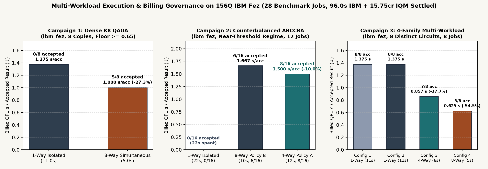

# Quality-Gated Spatial Packing & Billing Governance

*Portfolio Hub: [Prometheus Quantum Overview](https://github.com/PrometheusDynamicsCanada/prometheus-quantum-overview) · [Detailed Technical Report](DETAILED_TECHNICAL_REPORT.md) · [Data Dictionary](DATA_DICTIONARY.md)*

## Introduction

- **The question:** When multiple circuits share one quantum processor simultaneously to reduce billed time, how should software choose packing density so noisy chip regions do not cause rejections?
- **The test:** Across three sequential live studies (`29` unique provider records: `28` completed benchmark jobs + `1` superseded failover dispatch, `121` PUBs, `186,368` physical shots on `156Q` `ibm_fez`, `ibm_kingston`, and `54Q` `IQM Emerald`), we compared `1-way`, `4-way`, and `8-way` simultaneous packing under a strict two-wave lower confidence bound rule (`LCB >= 0.6500`).
- **The finding:** Across `8` distinct circuits spanning `4` families (`Campaign 3`), `8-way` packing accepted **`8/8` circuits in `5.00 s`**, lowering billed IBM seconds per accepted result by **`54.55%`** (`0.6250 s` vs. `1.3750 s` isolated). In a counterbalanced `ABCCBA` test near the quality floor (`Campaign 2`), stepping down to **quality-gated `4-way` (`1.5000 s/accepted`)** beat unconstrained `8-way` (`1.6667 s/accepted`) by **`-10.0%` billed time per accepted circuit** (`8/16` vs. `6/16` accepted).
- **The significance:** Teams reduce QPU spend when chip headroom is high while avoiding wasted runtime from over-packing weaker chip sectors.
- **The boundary:** On `IQM Emerald` dense `K_8` QAOA below `0.6500` (`Campaign 1`), neither `1-way` nor `4-way` cleared the acceptance floor (`0/8` accepted, though `4-way` cut credit spend `-38.46%`).
- **The evidence:** Opening progression chart and `Campaign 3` summary table below, with full `Campaign 1-2` ledgers and `numpy` histogram verification underneath.

*Opening summary: Provider-billed IBM QPU seconds per dual-wave accepted circuit across Campaigns 1, 2 (`ABCCBA`), and 3 (`4` circuit families).*

---

## Executive Summary (`Campaign 3`: `8` Circuits Across `4` Families on `156Q` `ibm_fez`, `N = 8` Jobs, `58,368` Shots)

*Hardware IDs:* `dbv0mmlarooc73fkok4g` .. `dbv0np5arooc73fkolcg` (`33.00 s` settled; `2,048` primary + `1,024` confirmation shots).

| Execution Arm (`8` Circuits) | Accepted `(↑)` | Billed `s` / Accepted `(↓)` | Output Agreement $F_B$ `*(mean)*` `(↑)` | Squared Hellinger $F_H$ `*(mean)*` `(↑)` | `HOP` `(↑)` / `TVD` `(↓)` `*(mean)*` | `XEB` `(↑)` / Entropy `*(mean)*` | `CZ` / Depth `*(mean)*` `(↓)` | Delta vs. Reference |
| :--- | :---: | :---: | :---: | :---: | :---: | :---: | :---: | :--- |
| **`Slot 1`: Isolated `1-Way` (Ref)** | **`8 / 8`** | `1.3750 s` (`11.0 s`) | `0.8801` | `0.7779` | `0.7030` / `0.3564` | `3.23` / `7.28` | `152.4` / `166.1` | Fixed-sector baseline |
| **`Slot 2`: Updated `1-Way`** | **`8 / 8`** | `1.3750 s` (`11.0 s`) | `0.8790` | `0.7789` | `0.7085` / **`0.3396`** | **`3.59`** / `7.19` | **`133.9` / `142.5`** | **`-12.14%` `CZ` gates** |
| **`Slot 3`: Matched `4-Way`** | `7 / 8` | `0.8571 s` (`6.0 s`) | `0.8777` | `0.7769` | `0.7092` / `0.3409` | `3.57` / `7.18` | **`133.9` / `142.5`** | **`-37.66%` `s/accepted`** |
| **`Slot 4`: Simultaneous `8-Way`** | **`8 / 8`** | **`0.6250 s` (`5.0 s`)** | **`0.8810`** | **`0.7795`** | **`0.7130`** / `0.3418` | `3.19` / `7.27` | `151.6` / `167.0` | **`-54.55%` `s/accepted`** |

*Metric Key:* Output-distribution agreement is Classical Bhattacharyya Overlap $F_B = \sum_x \sqrt{P_{\text{ideal}}(x)P_{\text{meas}}(x)}$ (labeled `"State Fidelity"` in Studio UIs); $F_H = F_B^2$; Shannon entropy is descriptive.

---

## Inspect the Evidence & Reproduce Supported Checks Offline

- **Command:** `python scripts/verify_quality_gated_packing.py`
- **Dependencies & measured runtime:** Python 3 + `numpy` (`0` cloud credentials, **`~0.15 s`** measured runtime; reconstructs all `112` circuit evaluations from raw shot histograms and checks SHA-256 digests).
- **Start a pilot:** [william@prometheusdynamics.ca](mailto:william@prometheusdynamics.ca) | [prometheusdynamics.ca](https://prometheusdynamics.ca)

---

## Full Campaign 1 & 2 Tables, Medians, Job IDs & Methodological Boundaries

<strong>1. Campaign 2 Counterbalanced ABCCBA (12 Jobs) & Campaign 1 Cross-Vendor Baseline (9 Records) - Click to expand</strong>

### Campaign 2: Counterbalanced `ABCCBA` (`1 -> 4 -> 8 -> 8 -> 4 -> 1`) on `ibm_fez` (`N = 12` Jobs, `44` PUBs, `67,584` Shots, `44.00 s`)
| Pooled Arm (`16` $K_8$ Evals) | Accepted `(↑)` | PUBs / Shots `(↓)` | Billed `s` / Accepted `(↓)` | `CZ` / Depth `*(mean)*` `(↓)` | $F_B$ `*(mean / med)*` `(↑)` | $F_H$ `*(mean / med)*` `(↑)` | `TVD` `*(mean / med)*` `(↓)` | `HOP` / `XEB` / Ent `*(mean)*` |
| :--- | :---: | :---: | :---: | :---: | :---: | :---: | :---: | :---: |
| **`Isolated (1-Way)`** | `0 / 16` | `32` / `49,152` | Zero (`22.00 s`) | `206.0` / `223.0` | `0.6310` / `0.6306` | `0.3982` / `0.3976` | `0.6621` / `0.6643` | `0.5021` / `0.2015` / `7.84` |
| **`4-Way Policy A`** | **`8 / 16`** | `8` / `12,288` | **`1.5000 s` (`12.0 s`)** | **`192.3` / `206.8`** | **`0.6958` / `0.7031`** | **`0.4848` / `0.4943`** | **`0.6062` / `0.5986`** | **`0.5338` / `0.4366`** / `7.78` |
| **`8-Way Policy B`** | `6 / 16` | **`4` / `6,144`** | `1.6667 s` (**`10.0 s`**) | `199.1` / `215.1` | `0.6901` / `0.6929` | `0.4774` / `0.4801` | `0.6079` / `0.6052` | `0.5326` / `0.4220` / `7.78` |

### Campaign 1: Cross-Vendor `K_8` QAOA Baseline & Boundary (`8` Bench Jobs + `1` Superseded Aux `dbuo2p782tmc73dtohkg`, `39` PUBs, `60,416` Shots)
| Processor & Arm | Accepted `(↑)` | PUBs / Shots `(↓)` | Billed / Accepted `(↓)` | `2Q` / Depth `*(mean)*` `(↓)` | $F_B$ `*(mean / med)*` `(↑)` | $F_H$ `*(mean / med)*` `(↑)` | `TVD` `*(mean / med)*` `(↓)` | Outcome |
| :--- | :---: | :---: | :---: | :---: | :---: | :---: | :---: | :--- |
| **`ibm_fez` `1-Way`** | **`8 / 8`** | `16` / `24,576` | `1.3750 s` (`11.0 s`) | **`189.0` / `200.0`** | **`0.7320` / `0.7301`** | **`0.5359` / `0.5330`** | **`0.5750` / `0.5761`** | Isolated baseline |
| **`ibm_fez` `8-Way`** | `5 / 8` | **`2` / `3,072`** | **`1.0000 s` (`5.0 s`)** | `198.1` / `216.0` | `0.6994` / `0.7131` | `0.4910` / `0.5086` | `0.5978` / `0.5889` | **`-27.27%` `s/accepted`** |
| **`iqm_emerald` `1-Way`** | `0 / 8` | `16` / `24,576` | Zero (`9.75 cr`) | **`214.0` / `189.0`** | `0.6118` / `0.6113` | `0.3743` / `0.3737` | `0.6805` / `0.6788` | Boundary (`< 0.6500`) |
| **`iqm_emerald` `4-Way`** | `0 / 8` | `4` / `6,144` | Zero (**`6.00 cr`**) | `222.5` / `204.0` | `0.5930` / `0.5936` | `0.3517` / `0.3524` | `0.6953` / `0.6951` | **`-38.46%` credits** |

*(Campaign 3 medians: $F_B$ `0.8844`, `0.9124`, `0.9101`, `0.8839`; $F_H$ `0.7821`, `0.8325`, `0.8283`, `0.7814`; `TVD` `0.3341`, `0.2952`, `0.3013`, `0.3256`.)*

<strong>2. Per-Family Scientific Chart & Methodological Boundaries - Click to expand</strong>

- **Parameterization & sequential design:** Campaign 3's `W4a_CompleteK8_QAOA` uses `RZ` angles `0.660456 / 3.079488 rad` vs. `0.330228 / 1.539744 rad` in Campaigns 1-2, and executed sequentially (`1 -> 1 -> 4 -> 8`) under calibration ID `2026-11-18T17:09:06-03:00`. Ledgers: [`data/ALL_29_PROVIDER_JOBS_LEDGER.csv`](data/ALL_29_PROVIDER_JOBS_LEDGER.csv) · [`data/ALL_112_CIRCUIT_EVALUATIONS_LEDGER.csv`](data/ALL_112_CIRCUIT_EVALUATIONS_LEDGER.csv).

