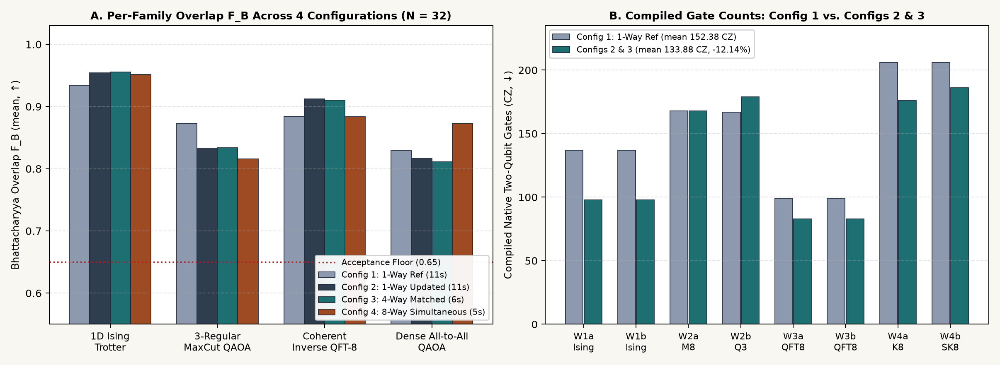

# Quality-Gated Spatial Packing and Billing Governance on Cloud Quantum Hardware

*Explore the portfolio: [Prometheus Quantum Overview](https://github.com/PrometheusDynamicsCanada/prometheus-quantum-overview)*

**Packing multiple quantum circuits onto one processor lowers billed runtime, but optimal packing density depends on live chip sector quality and circuit structure.**

Across three sequential live hardware validation studies (`29` unique provider records: `28` completed benchmark jobs + `1` superseded queue dispatch, `121` physical PUBs, `186,368` physical measurement shots, `96.00 s` IBM Quantum and `15.75 credits` IQM Resonance settled with `0.0000` ledger discrepancy), we tested simultaneous spatial packing, counterbalanced `4-way` versus `8-way` quality gating, and placement-matched multi-family execution under strict dual-wave confidence-bound acceptance (`LCB >= 0.6500` across `2,048` primary + `1,024` confirmation shots):

- **Campaign 3 (`ibm_fez`, `8` distinct circuits across `4` families):** `8-way` simultaneous packing accepted **`8/8` circuits in `5.00 s`**, reducing provider-billed QPU time per accepted result by **`54.55%`** (`0.6250 s` vs. `1.3750 s` isolated). Placement- and routing-matched `4-way` packing cut PUB evaluations by **`75.00%`** (`16` to `4`) and QPU time per accepted result by **`37.66%`** (`0.8571 s`), with an observed `-0.0013` mean overlap difference versus matched `1-way` execution.
- **Campaign 2 (`ibm_fez`, counterbalanced `ABCCBA` `1 -> 4 -> 8 -> 8 -> 4 -> 1` near the acceptance floor):** When weaker chip sectors hovered near threshold (`0/16` isolated passes in `22.00 s`), **quality-gated `4-way` packing (`8/16` accepted, `1.5000 s/accepted`)** beat unconstrained `8-way` packing (`6/16` accepted, `1.6667 s/accepted`), delivering **`33.3%` more accepted results** at **`10.0%` lower billed time per accepted output**.
- **Campaign 1 (`ibm_fez` + `IQM Emerald` cross-vendor baseline):** `8-way` packing on `ibm_fez` reduced billed QPU seconds per accepted $K_8$ MaxCut circuit by **`27.27%`** (`1.3750 s` to `1.0000 s`), while `IQM Emerald` established an explicit operating boundary (`0/8` accepted in both arms, with `4-way` packing cutting credit spend from `9.75` to `6.00 credits`).

**[Detailed results](DETAILED_TECHNICAL_REPORT.md) · [Verify the evidence](#verify-the-evidence) · [Discuss a pilot](#discuss-a-pilot)**


*Opening summary: Provider-billed IBM QPU seconds per accepted circuit (counting 100% of runtime spent on rejected/inconclusive outputs) across Campaign 1 (dense K8 QAOA, `-27.27%`), Campaign 2 (counterbalanced ABCCBA near threshold, `4-way` `1.5000 s` vs. `8-way` `1.6667 s`), and Campaign 3 (8 distinct circuits across 4 families, `8-way` `0.6250 s` [`-54.55%`] and placement-matched `4-way` `0.8571 s` [`-37.66%`]).*

---

## 1. Executive Summary & Principal Three-Campaign Benchmark Tables

> [!NOTE]
> **Metric, Accounting & Interpretation Conventions (`python scripts/verify_quality_gated_packing.py`):**
> - **Explicit Metric Definitions:** Classical Bhattacharyya Distribution Overlap is $F_B = \sum_x \sqrt{P_{\text{ideal}}(x) P_{\text{meas}}(x)}$ (labeled `"State Fidelity"` in Studio UI screenshots), distinct from Squared Hellinger Fidelity $F_H = F_B^2$ and Total Variation Distance $\text{TVD} = \frac{1}{2}\sum_x |P_{\text{ideal}}(x) - P_{\text{meas}}(x)|$. Output accuracy is evaluated via reference-distribution agreement ($F_B$, $F_H$, `TVD`); **Shannon entropy is reported descriptively** because lower entropy alone does not establish better output quality. Direction indicators `(↑)` and `(↓)` mark optimality; **bold** marks row/cohort winners.
> - **Primary Economic Outcome:** Total provider-billed QPU units (`seconds` or `credits`) divided by dual-wave accepted circuits (`primary_lcb >= 0.6500` and `confirm_lcb >= 0.6500`), charging 100% of rejected and inconclusive outputs against accepted yield.

### Table 1A: Campaign 3 - Heterogeneous 4-Family Multi-Workload Validation on `156Q` `ibm_fez` (`N = 8` IBM Jobs, `4` Runs, `32` Logical Evaluations Across `8` Distinct Circuits, `38` PUBs, `58,368` Physical Shots, `33.00 s` Settled)

*Single reported calibration ID: `2026-11-18T17:09:06-03:00` (`manifest_sha256 = 363fedc6...3dc4f`). Hardware Job IDs: Slot 1 (`dbv0mmlarooc73fkok4g`, `dbv0msnf8rhs73bn3j7g`), Slot 2 (`dbv0n1vf8rhs73bn3jhg`, `dbv0n7larooc73fkokr0`), Slot 3 (`dbv0ncf82tmc73du7fs0`, `dbv0nhups3fc73bjls40`), Slot 4 (`dbv0nl782tmc73du7g60`, `dbv0np5arooc73fkolcg`).*

| Arm (`8` Distinct Circuits Across `4` Families) | Accepted `(↑)` | PUBs / Shots `(↓)` | Billed QPU Time / `RU` `(↓)` | Billed `s` / Accepted `(↓)` | Distinct Islands / Island Config `(↑)` | Compiled `CZ` / Depth `*(mean)*` `(↓)` | Overlap $F_B$ `*(mean / median)*` `(↑)` | Hellinger $F_H$ `*(mean / median)*` `(↑)` | `TVD` `*(mean / median)*` `(↓)` | `HOP` `(↑)` / `XEB` `(↑)` / Entropy *(descriptive)* `*(mean)*` | `% Delta` vs. Reference Arm |
| :--- | :---: | :---: | :---: | :---: | :---: | :---: | :---: | :---: | :---: | :---: | :---: |
| **`Slot 1`: Configuration 1: Reference Isolated (`1-Way`)** | **8 / 8** | 16 / 24,576 | 11.00 s / 0.166788 | 1.3750 s | 1 / Single-circuit PUB | 152.38 / 166.12 | 0.8801 / 0.8844 | 0.7779 / 0.7821 | 0.3564 / 0.3341 | 0.7030 / 3.2323 / 7.2764 | Baseline (`1` fixed sector) |
| **`Slot 2`: Configuration 2: Updated Isolated (`1-Way`)** | **8 / 8** | 16 / 24,576 | 11.00 s / 0.165858 | 1.3750 s | 7 / Single-circuit PUB | **133.88 / 142.50** | 0.8790 / **0.9124** | 0.7789 / **0.8325** | **0.3396 / 0.2952** | 0.7085 / **3.5885** / 7.1865 | **-12.14% `CZ`, -4.71% `TVD`, +3.17% med $F_B$** *(vs. S1)* |
| **`Slot 3`: Configuration 3: Placement-Matched (`4-Way`)** | 7 / 8 | 4 / 6,144 | 6.00 s / 0.084338 | 0.8571 s | 7 / **matched islands** *(matched S2)* | **133.88 / 142.50** | 0.8777 / 0.9101 | 0.7769 / 0.8283 | 0.3409 / 0.3013 | 0.7092 / 3.5716 / 7.1826 | **-75.00% PUBs, -45.45% `s`, -37.66% `s/acc`** *(vs. S2)* |
| **`Slot 4`: Configuration 4: Simultaneous (`8-Way`)** | **8 / 8** | **2 / 3,072** | **5.00 s / 0.070787** | **0.6250 s** | **8 / matched islands** | 151.62 / 167.00 | **0.8810** / 0.8839 | **0.7795** / 0.7814 | 0.3418 / 0.3256 | **0.7130** / 3.1869 / 7.2743 | **-54.55% `s` & `s/acc`, -57.56% `RU/acc`** *(vs. S1)* |

### Table 1B: Campaign 2 - Two-Block Counterbalanced `ABCCBA` Packing Comparison on `156Q` `ibm_fez` (`N = 12` IBM Jobs, `6` Runs, `48` Evaluations, `44` PUBs, `67,584` Physical Shots, `44.00 s` Settled)

*Order `1 -> 4 -> 8 -> 8 -> 4 -> 1` (`manifest_sha256 = 0341e7f8...d4026`). Hardware Job IDs: Isolated (`dbuuohmps3fc73bjjb5g`, `dbuuonff8rhs73bn100g`, `dbuuqg782tmc73du4vb0`, `dbuuqkdarooc73fkm3sg`), Quality-Gated `4-Way` (`dbuuovlarooc73fkm1tg`, `dbuup6v82tmc73du4tng`, `dbuuptf82tmc73du4ul0`, `dbuuq1n82tmc73du4up0`), Unconstrained `8-Way` (`dbuupblarooc73fkm2d0`, `dbuupfn82tmc73du4u2g`, `dbuupkmps3fc73bjjcd0`, `dbuupomps3fc73bjjcig`).*

| Pooled Two-Block Arm (`16` $K_8$ Evaluations / Arm) | Accepted `(↑)` (`Block 1 + Block 2`) | PUBs / Shots `(↓)` | Billed QPU Time / `RU` `(↓)` | Billed `s` / Accepted `(↓)` | Compiled `CZ` / Depth `*(mean)*` `(↓)` | Overlap $F_B$ `*(mean / median)*` `(↑)` | Hellinger $F_H$ `*(mean / median)*` `(↑)` | `TVD` `*(mean / median)*` `(↓)` | `HOP` `(↑)` / `XEB` `(↑)` / Entropy *(descriptive)* `*(mean)*` | `% Delta: Quality-Gated 4-Way vs. 8-Way` |
| :--- | :---: | :---: | :---: | :---: | :---: | :---: | :---: | :---: | :---: | :---: |
| **`Isolated (1-Way)`** | 0 / 16 (`0 + 0`) | 32 / 49,152 | 22.00 s / 0.335820 | Zero accepted (`22.00 s` spent) | 206.00 / 223.00 | 0.6310 / 0.6306 | 0.3982 / 0.3976 | 0.6621 / 0.6643 | 0.5021 / 0.2015 / 7.8447 | Fixed sector below `0.6500` floor |
| **`4-Way Policy A`** | **8 / 16 (`4 + 4`)** | 8 / 12,288 | 12.00 s / 0.175341 | **1.5000 s** | **192.25 / 206.75** | **0.6958 / 0.7031** | **0.4848 / 0.4943** | **0.6062 / 0.5986** | **0.5338 / 0.4366** / 7.7755 | **+33.33% accepted, -10.00% `s/acc`** |
| **`8-Way Policy B`** | 6 / 16 (`3 + 3`) | **4 / 6,144** | **10.00 s / 0.145685** | 1.6667 s | 199.12 / 215.12 | 0.6901 / 0.6929 | 0.4774 / 0.4801 | 0.6079 / 0.6052 | 0.5326 / 0.4220 / 7.7794 | Reference packed baseline |

### Table 1C: Campaign 1 - Cross-Vendor `K_8` MaxCut QAOA Baseline & Boundary Study (`N = 8` Completed Benchmark Jobs + `1` Superseded Auxiliary Job, `39` PUBs, `60,416` Physical Shots, `19.00 s` IBM + `15.75 cr` IQM Settled)

*Completed Job IDs: `ibm_fez` Isolated (`dbuo44vf8rhs73bmkmfg`, `dbuo49ff8rhs73bmkml0`), `ibm_fez` Packed (`dbuo3r6ps3fc73bj77p0`, `dbuo3vvf8rhs73bmkm70`), `iqm_emerald` Isolated (`01a1ee45-0e89-7555-aa9c-23d44f35240f`, `01a1ee45-44ee-763c-b368-12444b04afb5`), `iqm_emerald` Packed (`01a1ee44-b6ff-7069-ad7e-725f46e209e1`, `01a1ee44-ddb3-70b8-9d32-58671b9d65b0`). Superseded queue-failover job settled in ledger: `ibm_kingston` `dbuo2p782tmc73dtohkg` (`3.00 s`, `1` PUB, `2,048` shots).*

| Processor & Arm (`8` $K_8$ Copies / Arm) | Accepted `(↑)` | PUBs / Shots `(↓)` | Settled Provider Usage `(↓)` | Billed Units / Accepted `(↓)` | Compiled `2Q` / Depth `*(mean)*` `(↓)` | Overlap $F_B$ `*(mean / median)*` `(↑)` | Hellinger $F_H$ `*(mean / median)*` `(↑)` | `TVD` `*(mean / median)*` `(↓)` | Expected Cut `(↑)` / $P(\text{Cut}=16)$ `(↑)` `*(mean)*` | `% Delta: Packed vs. Isolated` |
| :--- | :---: | :---: | :---: | :---: | :---: | :---: | :---: | :---: | :---: | :---: |
| **`ibm_fez` Isolated (`1-Way`)** | **8 / 8** | 16 / 24,576 | 11.00 s (0.167427 RU) | 1.3750 s | **189.00 / 200.00** | **0.7320 / 0.7301** | **0.5359 / 0.5330** | **0.5750 / 0.5761** | **14.377 / 0.4408** | Isolated `ibm_fez` baseline |
| **`ibm_fez` Packed (`8-Way`, frozen spacing policy)** | 5 / 8 | **2 / 3,072** | **5.00 s (0.073149 RU)** | **1.0000 s** | 198.12 / 216.00 | 0.6994 / 0.7131 | 0.4910 / 0.5086 | 0.5978 / 0.5889 | 14.316 / 0.4158 | **-54.55% `s` spent, -27.27% `s/accepted`** |
| **`iqm_emerald` Isolated (`1-Way`)** | 0 / 8 | 16 / 24,576 | 9.75 credits | Zero accepted (`9.75 cr`) | **214.00 / 189.00** | 0.6118 / 0.6113 | 0.3743 / 0.3737 | 0.6805 / 0.6788 | 14.051 / 0.2932 | Operating boundary (`< 0.6500`) |
| **`iqm_emerald` Packed (`4-Way`, frozen spacing policy)** | 0 / 8 | 4 / 6,144 | **6.00 credits** | Zero accepted (`6.00 cr`) | 222.50 / 204.00 | 0.5930 / 0.5936 | 0.3517 / 0.3524 | 0.6953 / 0.6951 | 14.008 / 0.2768 | **-38.46% credit spend** at boundary |

---

## 2. Methodological Scope & Interpretation Boundaries

1. **Cross-Campaign $K_8$ Circuit Parameterization Difference:** Campaign 3's `W4a_CompleteK8_QAOA` (`qasm_sha256 = d62e7b5f...`) uses cost-layer `RZ` angles `0.660456 / 3.079488 rad`, whereas Campaign 1 and Campaign 2 (`C12_K8_MaxCut_QAOA_p2`, `qasm_sha256 = 015e55f9...`) use `0.330228 / 1.539744 rad`. Cross-campaign overlap differences therefore combine circuit parameterization changes with calibration changes and do not establish physical sector recovery.
2. **Placement-Matched Sequential Design in Campaign 3 (`Slot 3` vs. `Slot 2`):** Matching `subgraph_sha256_ids` and compiled gate/depth structures removes placement and compilation co-variation between `Slot 2` (`1-way`) and `Slot 3` (`4-way`), recording `-0.0013` mean $\Delta F_B$ alongside `-45.45%` billed QPU time (`-75.00%` PUBs). Because Campaign 3 executed in a single sequential pass (`1 -> 1 -> 4 -> 8`) inside the remaining `45.00 s` quota rather than repeated counterbalanced blocks, temporal drift is not experimentally cancelled.
3. **Calibration IDs vs. Real-Time Noise:** `ABCCBA` counterbalancing in Campaign 2 balances discrete slot order (`mean slot = 3.5`), and Campaign 3 ran under a single reported provider calibration ID (`2026-11-18T17:09:06-03:00`); neither guarantees stationary real-time device noise.



---

## Verify the Evidence

**Verification Kind:** Direct **raw-measurement histogram reconstruction** (`numpy` + Python standard library only; zero cloud credentials). Recomputes all `112` logical circuit evaluations (`224` wave histograms across `120` completed physical PUBs and `184,320` benchmark shots + `1` superseded auxiliary record = `29` unique provider records, `121` PUBs, `186,368` total shots), dual-wave `LCB >= 0.6500` acceptance classifications, `subgraph_sha256` island matching, and `REPO_SHA256_MANIFEST.json` byte integrity:

```bash
python scripts/verify_quality_gated_packing.py
```

- **Key files:** [`DETAILED_TECHNICAL_REPORT.md`](DETAILED_TECHNICAL_REPORT.md) · [`data/ALL_29_PROVIDER_JOBS_LEDGER.csv`](data/ALL_29_PROVIDER_JOBS_LEDGER.csv) · [`data/ALL_112_CIRCUIT_EVALUATIONS_LEDGER.csv`](data/ALL_112_CIRCUIT_EVALUATIONS_LEDGER.csv) · [`DATA_DICTIONARY.md`](DATA_DICTIONARY.md) · [`PUBLIC_DISCLOSURE.md`](PUBLIC_DISCLOSURE.md) · [`REPO_SHA256_MANIFEST.json`](REPO_SHA256_MANIFEST.json)

---

## Discuss a Pilot

**Bring a representative workload and an acceptance criterion. We can compare Prometheus with your existing execution approach and measure quality, acceptance rate and charged hardware resources.**

- **Contact:** [william@prometheusdynamics.ca](mailto:william@prometheusdynamics.ca) | [prometheusdynamics.ca](https://prometheusdynamics.ca)
